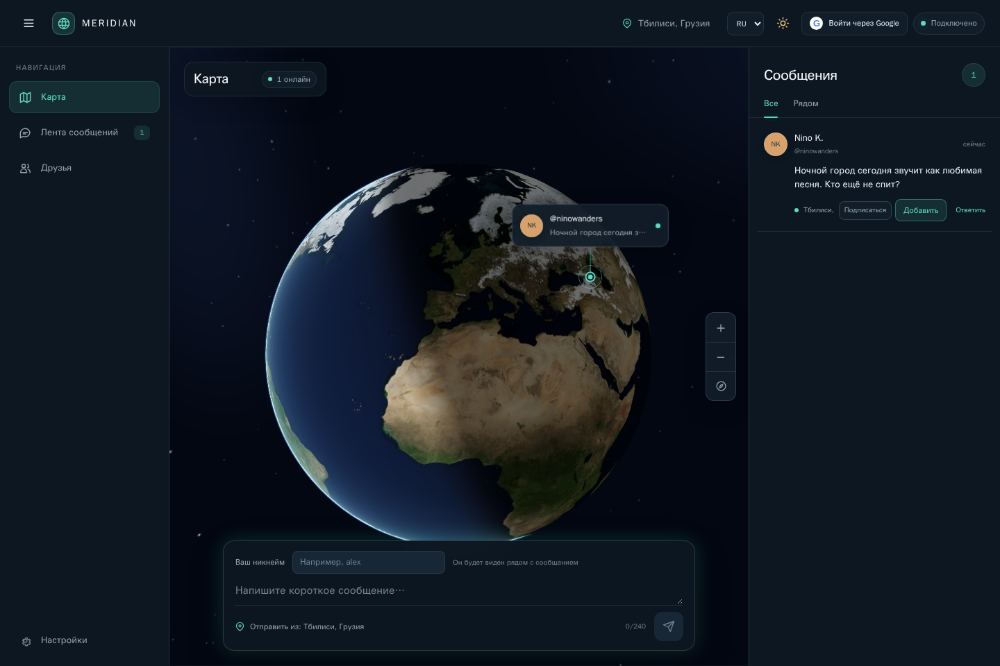
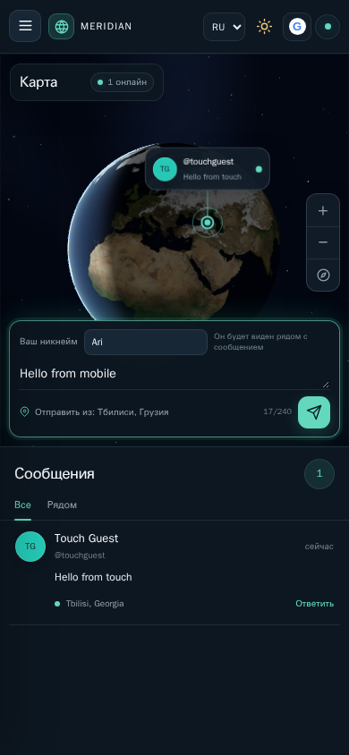

# Just the Messenger

A work-in-progress, guest-first geochat. Open the globe, leave a short public message, and meet people nearby. The public map and live message delivery work; private conversations and attachments are not implemented yet.

## Preview





## Run locally

Requirements: Docker Engine and Docker Compose v2.

```sh
git clone https://github.com/evgeniyprosvirynGit/just-the-messenger.git
cd just-the-messenger
cp .env.example .env
```

Edit `.env` and replace `POSTGRES_PASSWORD` with a long, random password. Then start the app:

```sh
docker compose up --build -d
```

Open <http://localhost:8090>. Change `WEB_PORT` in `.env` to use a different local port.

To view logs or stop the app:

```sh
docker compose logs -f web api
docker compose down
```

`docker compose down -v` also deletes the local PostgreSQL data.

## Optional services

- **Detailed satellite imagery:** set `VITE_MAPTILER_API_KEY` in `.env` to a browser key restricted to your app origin, then rebuild with `docker compose up --build -d`. The key is public in the built web app. Without it, the app uses its bundled NASA imagery and limits close zoom.
- **Google sign-in:** set `GOOGLE_CLIENT_ID`, `GOOGLE_CLIENT_SECRET`, and `GOOGLE_REDIRECT_URL`. Register `http://localhost:8090/api/auth/google/callback` as the OAuth callback. Guest posting does not require Google credentials.

## Run Playwright

```sh
docker compose -f compose.yaml -f compose.test.yaml --profile test run --build --rm playwright
```

Playwright runs Chromium in Docker and writes screenshots, traces, and the HTML report under `web/test-results/`.

For architecture and development details, see [`docs/ARCHITECTURE.md`](docs/ARCHITECTURE.md) and [`docs/DEVELOPMENT.md`](docs/DEVELOPMENT.md).
