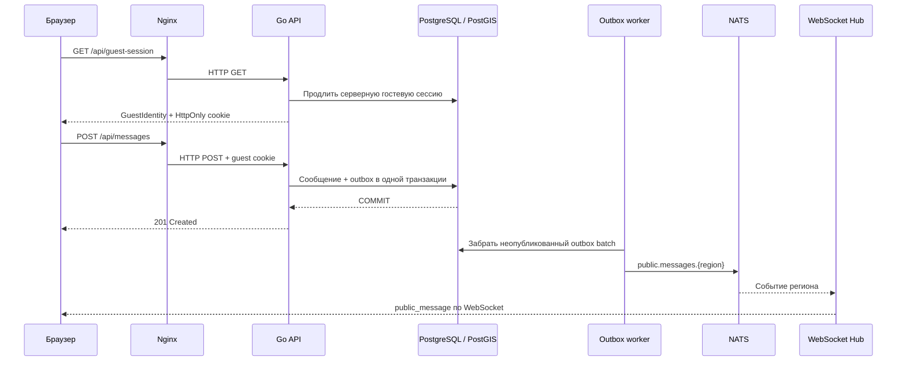

# Архитектура Meridian

## Компоненты

| Часть | Технологии | Ответственность |
| --- | --- | --- |
| Web | React, TypeScript, Vite, CesiumJS | Интерфейс, глобус, форма публикации, лента и WebSocket-клиент |
| API | Go, `net/http` | REST, проверка и нормализация публикаций, WebSocket endpoint |
| Хранилище | PostgreSQL, PostGIS | Активные сообщения, пространственные запросы и transactional outbox |
| Брокер | NATS | Региональная доставка сообщений, дружбы и эфемерных snapshots присутствия между API-репликами |
| Reverse proxy | Nginx | Статика, `/api/*`, `/ws`, health endpoint |
| Окружение | Docker Compose | Сеть сервисов, health checks и постоянный том PostgreSQL |

## Публикация и доставка



REST-контракт отправки:

```http
POST /api/messages
Content-Type: application/json

{"body":"Привет из Тбилиси","latitude":41.7151,"longitude":44.8271}
```

Перед публикацией клиент создаёт или обновляет гостевую сессию через `POST /api/guest-session` с `{"nickname":"Mila"}`. Сервер нормализует никнейм, резервирует уникальный case-folded ключ и возвращает идентичность с `HttpOnly`, `SameSite=Lax` cookie. Cookie содержит случайный 256-битный токен; PostgreSQL хранит его SHA-256 и профиль гостя. Сессия продлевается при активности и истекает через 30 дней без активности. `localStorage` содержит только удобный префилл никнейма, не токен.

## Google sign-in

Google-вход необязателен. При пустых `GOOGLE_CLIENT_ID` и `GOOGLE_CLIENT_SECRET` API сообщает клиенту, что кнопка входа выключена; частичная конфигурация останавливает запуск API. Для входа API использует OIDC discovery, authorization-code flow и только scope `openid`. Клиентский секрет и обмен кода остаются на сервере.

Маршруты: `GET /api/auth/google/config` сообщает доступность функции; `GET /api/auth/google/start` создаёт попытку и перенаправляет пользователя к провайдеру; `GET /api/auth/google/callback` обрабатывает ответ; `POST /api/auth/logout` завершает текущую сессию.

Таблица `google_auth_attempts` хранит на короткое время SHA-256 хеш OAuth `state`, SHA-256 хеш текущего guest-session token, `nonce`, PKCE verifier, признак временного профиля и время истечения. Попытка одноразовая и привязана к cookie исходного браузера. В callback сервер проверяет привязку, меняет код с PKCE verifier, проверяет подпись, issuer, audience и срок ID token средствами `go-oidc`, а `nonce` и непустой `sub` проверяет перед связыванием аккаунта. Повторно использовать state нельзя.

Таблица `google_accounts` хранит уникальное соответствие Google `sub` профилю; email, профильные claims, access token и refresh token не сохраняются. После успешного связывания сервер выдаёт новый случайный токен сессии и удаляет старую сессию. Существующий guest-профиль сохраняет никнейм, связи и публикации. Если Google `sub` уже связан с другим профилем, текущие данные гостя не перезаписываются. Logout удаляет сессию в БД и очищает cookie. Имя и ограничения внешнего callback URL берутся из конфигурации, а не из запроса браузера.

Production использует issuer `https://accounts.google.com` и зарегистрированный точный HTTPS callback. Только Compose Playwright-конфигурация включает локальный HTTP OIDC mock через `GOOGLE_OIDC_ALLOW_INSECURE=true`; эту настройку нельзя включать при развёртывании.

## Настройки времени показа сообщений

Гостевой выбор хранится в `localStorage`. Длительность ограничена значениями 6, 12 и 24 секунды, значение по умолчанию — 12. Когда гость впервые связывает профиль с Google, сохранённый гостевой выбор переносится в аккаунт, если в нём ещё нет собственного значения.

`GET /api/account/settings` и идемпотентный `PUT /api/account/settings` доступны только для текущей сессии со связанным Google-профилем. Сервер получает `profile_id` из подписанной сессионной cookie, не принимает его от клиента, отвечает с `Cache-Control: no-store` и проверяет allowlist вариантов. Так endpoint не позволяет клиенту подменить ID профиля. Значение хранится в `profile_preferences`, связанной внешним ключом с `guest_profiles` и ограниченной SQL `CHECK`.

Время показа отсчитывается на клиенте с момента получения сообщения зрителем и ограничивается более ранним из выбранного срока и серверного `expires_at`. Публикация хранится для realtime-backfill 30 секунд — на 6 секунд больше максимального клиентского срока; настройки зрителя не влияют на retention. Уважайте `prefers-reduced-motion`: в этом режиме карточка удаляется в момент окончания срока без дополнительной fade-задержки.

Ответ `201` на публикацию содержит автора, выведенного из серверной сессии; тело запроса принимает только текст и координаты и отклоняет неизвестные поля. Публичные координаты округляются на сервере до двух знаков, серверный срок хранения — 30 секунд. Профиль может отправить не чаще одного публичного сообщения за две секунды; лимит атомарно применяется в PostgreSQL и сохраняется между API-репликами. При превышении API возвращает `429`, точный остаток ожидания в `Retry-After` (целые секунды, округление вверх) и `Cache-Control: no-store`. Web-клиент показывает локализованное время ожидания и сохраняет черновик.

Nginx дополнительно ограничивает `POST /api/guest-session` до 10 запросов в минуту на исходный IP с burst 2. Ключ берётся из `$binary_remote_addr`, поэтому подмена клиентского `X-Forwarded-For` не создаёт новый лимит; отказ возвращает JSON `429`, `Retry-After: 6` и `Cache-Control: no-store`. Shared-memory зона работает между worker-процессами одного Nginx, но не синхронизируется между разными ingress-репликами. При размещении за внешним балансировщиком нужно настраивать real-IP только для известных trusted proxy CIDR; для нескольких ingress-реплик нужен общий rate-limit service или лимит на внешнем edge. Это дополнительная защита от массового создания профилей, не замена глобальному антиспаму.

Для realtime клиент подключается к `/ws` и отправляет управляющее событие:

```json
{"type":"subscribe","cells":["sz"]}
```

Успешное подтверждение приходит после того, как NATS обработал новую подписку:

```json
{"type":"subscription_ready","cells":["sz"]}
```

Hub сериализует изменения подписок и выполняет `FlushTimeout` для новых регионов до подтверждения. Интерфейс показывает статус «Подключено» только после `subscription_ready` для текущего набора geocell и затем восстанавливает активные сообщения через REST. Тот же backfill выполняется после reconnect. При ошибке Hub очищает частично добавленные регионы и закрывает WebSocket. Это важно для Core NATS: публикации не сохраняются для подписчиков, которые ещё не активны.

Публикуемое событие имеет вид:

```json
{"type":"public_message","message":{"id":"…","body":"Привет из Тбилиси"}}
```

`sz` — двухсимвольная geocell Тбилиси в текущей реализации. Для других координат регион вычисляет `server/regionFor`. WebSocket Hub держит подписки только на регионы с активными зрителями. При смене области просмотра клиент обновляет список cells, а при переподключении REST API возвращает ещё не истёкшие сообщения.

## Счётчик активных сессий

Счётчик означает открытые WebSocket-сессии карты, а не уникальных людей или профили; две вкладки одного браузера считаются отдельно. Это приблизительное число активных сессий. Клиент получает только событие `online_count` с числом, без идентификаторов, ников, геоячеек и координат:

```json
{"type":"online_count","count":42}
```

Каждая API-реплика считает собственные активные sockets и раз в 2 секунды публикует в Core NATS subject `planet-chat.presence.api` маленький versioned snapshot `{type,nodeId,count,sequence}`. Каждая реплика получает снимки остальных узлов и держит их как lease на 8 секунд; собственный node ID и устаревшие sequence игнорируются. Упавшая реплика исключается по истечении lease, а reconnect восстанавливает агрегат новым heartbeat. UI обновляет число только при WebSocket-событии; Hub отправляет новое значение локальным клиентам не чаще одного раза в секунду и только при изменении count.

NATS Core доставляет сообщение только текущим подписчикам и не хранит его; счётчик намеренно eventual-consistent, потому что следующий heartbeat заменяет пропущенный snapshot. При подключении новая API-реплика сходится с другими за несколько секунд; после аварийного отключения устаревшее значение может оставаться до 8 секунд плюс интервал UI broadcast. Heartbeat не записывается в PostgreSQL. Источник истины — живые локальные WebSocket-сессии и периодические снимки, а не сохранённая история присутствия.

## Запросы в друзья

Дружба — отдельная взаимная связь; подписка на автора её не создаёт. guest_friend_requests хранит отправителя, получателя и состояние (pending, accepted, declined, cancelled, removed). Частичный уникальный индекс на неупорядоченную пару профилей допускает только один активный запрос или дружбу, включая встречные запросы. Создание запроса сначала блокирует две строки профилей в стабильном порядке UUID, затем проверяет активную связь и дневной лимит внутри одной транзакции. Так параллельные запросы между несколькими API-репликами не обходят ограничение и не создают дублей.

REST:

- GET /api/friendships?profileIds=… возвращает состояние связи только между текущим гостем и указанными UUID.
- GET /api/friend-requests?view=incoming|outgoing|friends&limit=20&cursor=… возвращает ограниченную keyset-пагинацию.
- POST /api/friend-requests принимает только profileId; requester_profile_id выводится из серверной HttpOnly cookie.
- Получатель меняет состояние через PUT /api/friend-requests/{requestId}/accept|decline; отправитель отменяет через DELETE /api/friend-requests/{requestId}.
- Любая сторона удаляет принятую дружбу через DELETE /api/friends/{profileId}.

Каждое действие проверяет сессию и роль участника в запросе. Чужой или неизвестный идентификатор возвращает одинаковый 404; UUID не заменяет авторизацию. Списки ограничены 50 записями на страницу и содержат только публичные никнейм, handle и данные аватара; координаты и география сообщения в них не возвращаются. Повторные создания исходящего запроса и повторные операции принятия/отмены обрабатываются идемпотентно, встречный запрос и устаревшее состояние возвращают 409. Создание ограничено 20 запросами на профиль за 24 часа; PostgreSQL сохраняет лимит между репликами, а 429 содержит Retry-After и Cache-Control: no-store.

Интерфейс предоставляет входящие, отправленные и принятые связи, действия доступны с карточки публичного автора и раздела «Друзья». Это не открывает приватный чат: согласие на переписку и блокировки остаются отдельными задачами.

Realtime-обновления используют уже открытый WebSocket. Сервер разрешает browser origin на handshake средствами `coder/websocket` и связывает соединение только с профилем, найденным по HttpOnly guest cookie. Клиент не передаёт идентификатор адресата и не может подписаться на чужой профиль. В памяти Hub хранится ограниченная очередь отправки и локальные соединения по `profileID`; один wildcard NATS subscriber на API replica доставляет событие только в локальные сессии нужного профиля. Переполненная очередь закрывает медленное соединение, после reconnect интерфейс восстанавливает состояние через REST.

После каждой транзакции дружбы в `realtime_outbox` атомарно записывается событие для `social.profile.{recipientUUID}`. Payload содержит только `requestId` и `state` (`pending`, `accepted`, `declined`, `cancelled`, `removed`) и служит сигналом перечитать серверное состояние; имена, координаты, текст публикаций и настройки не передаются. Повторная публикация безопасна: клиент обновляет состояние идемпотентными REST-запросами. Core NATS не хранит сообщения для отключённых потребителей и доставляет только активным подписчикам, поэтому WebSocket event не является источником истины.

`guest_friend_requests.recipient_read_at` хранит прочтение входящего pending-запроса. Частичный индекс ускоряет подсчёт непросмотренных запросов. `GET /api/friend-requests/unread-count` возвращает профильный счётчик; `PUT /api/friend-requests/read` принимает не более 50 UUID видимых карточек и помечает прочитанными только pending-запросы, где текущий профиль — получатель. Открытие или повторная загрузка вкладки входящих помечает показанные элементы прочитанными. После входящего события UI обновляет счётчик и активную вкладку; после каждого нового WebSocket subscription ACK перечитывает актуальные связи, счётчик и активный список.

Основания: [OWASP WebSocket Security Cheat Sheet](https://cheatsheetseries.owasp.org/cheatsheets/WebSocket_Security_Cheat_Sheet.html), [NATS Core publish-subscribe delivery](https://docs.nats.io/learn/core-nats/publish-subscribe), [Playwright WebSocket testing](https://playwright.dev/docs/network).

Основания: [OWASP API1: Broken Object Level Authorization](https://api-security.owasp.org/editions/2023/en/0xa1-broken-object-level-authorization/), [OWASP API4: Unrestricted Resource Consumption](https://api-security.owasp.org/editions/2023/en/0xa4-unrestricted-resource-consumption/), [PostgreSQL partial indexes](https://www.postgresql.org/docs/current/indexes-partial.html) и [explicit locking](https://www.postgresql.org/docs/current/explicit-locking.html), [RFC 9110](https://www.rfc-editor.org/rfc/rfc9110.html), [WAI-ARIA Authoring Practices](https://www.w3.org/WAI/ARIA/apg/).

## Хранение и очистка

Создание сообщения и строки outbox выполняется в одной транзакции PostgreSQL. Worker берёт неопубликованные записи с `FOR UPDATE SKIP LOCKED`, отправляет их в NATS, подтверждает flush и только затем отмечает outbox-события опубликованными. Это позволяет повторить публикацию после перезапуска процесса, не теряя сохранённое сообщение.

Гостевой профиль хранит нормализованный никнейм, его case-folded уникальный ключ, handle, цвет аватара и время активности. `public_messages` сохраняет снимок имени и handle для уже отправленных публикаций и nullable ссылку на профиль. `guest_sessions` хранит только SHA-256 случайного токена из cookie; истёкшие сессии удаляются, неактивные профили удаляются после срока хранения при отсутствии активных публикаций. Параметры cookie и серверное хранение сессии выбраны по рекомендациям [OWASP Session Management](https://cheatsheetseries.owasp.org/cheatsheets/Session_Management_Cheat_Sheet.html).

Серверная фоновая задача удаляет истёкшие публикации. На клиенте `useMessageExpiry` отдельно владеет browser-таймерами: запускает 650 ms fade перед окончательным удалением карточки и маркера, снимает таймеры при уходе публикации из активной ленты или размонтировании, а для `prefers-reduced-motion` убирает дополнительную задержку. Такое разделение удерживает синхронизацию с таймерами в специализированном hook и очищает внешние ресурсы по модели React Effects ([Custom Hooks](https://react.dev/learn/reusing-logic-with-custom-hooks)). Playwright проверяет границы начала и конца анимации отдельно для карточки ленты и маркера карты.

## Подписки

Подписка — отдельная односторонняя связь гостевых профилей; она не даёт права на приватный диалог. `guest_follows` использует составной первичный ключ `(follower_profile_id, followed_profile_id)`, внешние ключи с `ON DELETE CASCADE` и `CHECK` против самоподписки. Первичный ключ предотвращает дубли даже при параллельных запросах; ограничения целостности закреплены в PostgreSQL согласно [документации по constraints](https://www.postgresql.org/docs/18/ddl-constraints.html). Перед подпиской сервер проверяет, что у целевого профиля есть ещё активное публичное сообщение; при этом `follower_profile_id` всегда берётся из серверной cookie-сессии, а не из параметра клиента.

REST-контракт первого среза:

```http
GET /api/follows?profileIds=7c65fe78-0f93-4a0f-a7dc-98d4ba4fb210,3fe3cda7-2f68-4901-9631-d9d979b52a3f
PUT /api/follows/7c65fe78-0f93-4a0f-a7dc-98d4ba4fb210
DELETE /api/follows/7c65fe78-0f93-4a0f-a7dc-98d4ba4fb210
```

Публичный DTO сообщения содержит `authorProfileId`, чтобы адресовать связь профиля независимо от отображаемого handle; для старых записей с удалённым профилем поле может отсутствовать. Handle остаётся отображаемым именем и не используется как ключ отношений. `GET` возвращает только переданные UUID, на которые подписан текущий гость; число ID ограничено 100, размер строки — допустимым максимумом с учётом запятых-разделителей ([OWASP API4:2023](https://api-security.owasp.org/editions/2023/en/0xa4-unrestricted-resource-consumption/)). `PUT` создаёт связь (`201`) или подтверждает уже существующую (`204`), `DELETE` идемпотентно отвечает `204`. Идемпотентная семантика соответствует [RFC 9110](https://www.rfc-editor.org/rfc/rfc9110.html#section-9.2.2); объектная авторизация выполняется серверной сессией согласно рекомендациям [OWASP API1:2023](https://api-security.owasp.org/editions/2023/en/0xa1-broken-object-level-authorization/) и не полагается на идентификатор подписчика от клиента. UUID снижает риск угадывания ключей, но не заменяет авторизационные проверки. Для мобильной и браузерной проверки Playwright использует отдельные контексты и реальные cookie-сессии ([Playwright API testing](https://playwright.dev/docs/api-testing)).

Сейчас follow/unfollow доступен на карточках публичных сообщений. Отдельная лента подписок и realtime-доставка публичных сообщений только подписчикам ещё не реализованы; после появления ленты её доставка должна использовать существующие границы PostgreSQL/outbox/NATS/WebSocket.

## Рендер глобуса

Звёздный фон создаётся локально в виде шести детерминированных PNG-граней cubemap; сборочный генератор `web/scripts/generate-starfield-skybox.mjs` использует Node built-ins и не требует сети или отдельных npm-зависимостей. `createStarSkyBox` подключает грани через опцию `skyBox` конструктора `CesiumWidget`; каждая грань — same-origin URL. Публичные API: [CesiumWidget `skyBox`](https://cesium.com/learn/cesiumjs/ref-doc/CesiumWidget.html) и [SkyBox sources](https://cesium.com/learn/cesiumjs/ref-doc/SkyBox.html). `configureSolarLighting` включает освещение поверхности и динамическую атмосферу от солнечного направления; `ClockStep.SYSTEM_CLOCK` синхронизирует сцену с системным UTC, поэтому терминатор дня/ночи и сезонный наклон Солнца вычисляются Cesium, а спутниковые снимки не подменяются сезонными данными. `requestRenderMode` остаётся включённым, а `maximumRenderTimeChange` равен 30 секундам: освещение обновляется редко, взаимодействие и глобальная авто-ротация явно запрашивают необходимые кадры. Playwright фиксирует UTC-время через `page.clock.setFixedTime` и сохраняет desktop/mobile screenshots равноденствия днём/ночью и обоих солнцестояний.

Карта использует `CesiumWidget`, потому что интерфейс Meridian сам предоставляет панель карты, действия, навигацию и отправку сообщений. `Viewer` собирает стандартные Cesium-панели в один компонент; отключение этих панелей через опции меняет их видимость, но не удаляет их из графа зависимостей. `CesiumWidget` создаёт необходимую сцену без этого UI и поддерживает используемые приложением camera, credits, resize, `requestRenderMode` и `scene3DOnly`; последний режим ограничивает геометрию 3D-представлением и экономит GPU-память. Клиент импортирует rendering API из `@cesium/engine`, а spatial primitives — из `@cesium/core`, не подключая агрегированный `cesium` пакет и неиспользуемые Widgets. Это официальный modular setup Cesium ([engine README](https://github.com/CesiumGS/cesium/blob/main/packages/engine/README.md), [core README](https://github.com/CesiumGS/cesium/blob/main/packages/core/README.md)); Cesium вынес core API в отдельный пакет с версии 1.146 ([release notes](https://github.com/CesiumGS/cesium/releases/tag/1.146)). Импорт `CesiumWidget.css` уменьшил Cesium CSS с 24.43 kB (5.49 kB gzip) до 1.83 kB (0.62 kB gzip), а копируемые build assets — с 396 до 307 файлов. A/B production-сборка при этом показала практически неизменный JS chunk: 3 971.20 kB raw и 1 055.53 kB gzip; browser `encodedBodySize` — 1 061 440 bytes. Поэтому это сокращает styles/assets/dependency graph, но не считается существенным уменьшением JS. Playwright удерживает compressed Cesium chunk ниже 1 120 000 bytes. API: [CesiumWidget](https://cesium.com/learn/cesiumjs/ref-doc/CesiumWidget.html), [Viewer](https://cesium.com/learn/cesiumjs/ref-doc/Viewer.html).

Cesium базово загружает локальную географическую пирамиду тайлов NASA Blue Marble из `web/public/earth/tiles/{z}/{x}/{y}.jpg`. Исходная equirectangular-текстура 5400×2700 хранится в `web/assets/earth-texture-source.jpg`; `web/scripts/generate-earth-tiles.sh` воспроизводимо создаёт 42 JPEG-тайла 512×512 для уровней 0–2. Путь `{z}/{x}/{y}` соответствует поддерживаемому Cesium `UrlTemplateImageryProvider`, а `GeographicTilingScheme` использует географическую/equirectangular проекцию. Статические workers/assets для `CESIUM_BASE_URL=/cesium/` копируются в web-образ из `node_modules/@cesium/engine/Build/**/*`. Тайлы входят в web-образ, поэтому стартовый глобус не зависит от внешнего tile API. Эта разбивка позволяет Cesium загружать и уточнять видимую подложку по мере необходимости вместо обязательной передачи единого изображения 5400×2700; Playwright проверяет локальный источник и объём закодированных данных меньше 1 884 678 байт исходной текстуры. Атрибут `data-earth-texture="loaded"` устанавливается после опустошения очереди, отслеживаемой через [Globe.tileLoadProgressEvent](https://cesium.com/learn/cesiumjs/ref-doc/Globe.html#tileLoadProgressEvent); если событие не сообщило финальный переход, текущее состояние очереди проверяется на следующем `postRender` через [`Globe.tilesLoaded`](https://cesium.com/learn/cesiumjs/ref-doc/Globe.html#tilesLoaded). Проверка прекращается после загрузки. Авторство и исходный датасет: [NASA Blue Marble: Next Generation](https://science.nasa.gov/earth/earth-observatory/blue-marble-next-generation/base-map/). Подход соответствует рекомендациям [Cesium по imagery layers](https://cesium.com/learn/cesiumjs-learn/cesiumjs-imagery/) и API [GeographicTilingScheme](https://cesium.com/learn/cesiumjs/ref-doc/GeographicTilingScheme.html) / [UrlTemplateImageryProvider](https://cesium.com/learn/cesiumjs/ref-doc/UrlTemplateImageryProvider.html). При заданном `VITE_MAPTILER_API_KEY` приложение добавляет поверх неё спутниковый слой MapTiler Satellite напрямую из CDN, только начиная с уровня детализации 4; без ключа внешних запросов нет. Для ключа требуется доменное ограничение и отдельные ключи по средам. `VITE_*` встраивается в клиентский bundle и не является секретом. Настроенный слой показывает обязательную атрибуцию MapTiler и OpenStreetMap в `CesiumWidget.creditContainer`. Клиент не проксирует и не кеширует тайлы на сервере. После двух повторов запросов и трёх окончательных ошибок тайлов подробный слой убирается, а NASA остаётся видимым fallback.

После первого успешного завершения локальной загрузки приложение один раз обновляет размеры `CesiumWidget` и вызывает `scene.requestRender()`, чтобы гарантировать кадр с готовой текстурой в `requestRenderMode`, в том числе после возврата страницы из внешней авторизации. Затем `data-globe-ready="true"` выставляется после следующего `postRender` и снимается одноразовый listener. В idle не запускается постоянная отрисовка. Сигналы загрузки и готового кадра используются Playwright для скриншотов после реального рендера.

`globeAutoRotation.ts` отвечает за едва заметное вращение только при глобальном обзоре (высота камеры не ниже 9 000 000 м). Раз в секунду камера поворачивается вокруг мировой оси Z на величину, соответствующую 0,06°/с, через публичный [`Camera.rotate`](https://cesium.com/learn/cesiumjs/ref-doc/Camera.html#rotate), после чего [`scene.requestRender()`](https://cesium.com/learn/cesiumjs/ref-doc/Scene.html#requestRender) запрашивает единичный кадр. Постоянный `requestAnimationFrame` для вращения не используется, поэтому сохраняется модель явного рендера Cesium и сцена не работает непрерывно. Настройки камеры задаются публичным [`ScreenSpaceCameraController`](https://cesium.com/learn/cesiumjs/ref-doc/ScreenSpaceCameraController.html). Вращение останавливается при pointer/wheel input и возвращается после 2,5 секунды бездействия; также оно приостановлено для скрытой вкладки, невидимого глобуса и видимого модального окна и отключено при `prefers-reduced-motion`. Смена видимости сбрасывает незавершённый pointer state, чтобы потерянный браузером pointerup не оставил камеру навсегда на паузе. Playwright измеряет изменение долготы камеры, draw calls/Long Tasks в спокойном глобальном виде и переходы pause/resume; это не оценка GPU FPS.

Слой требует выбранного владельцем коммерческого плана, подходящего для продукта, и ключа с ограничением разрешённых origin. Провайдерная интеграция опциональна и выключена по умолчанию; настоящий рендер MapTiler проверяется после настройки ключа в целевой среде.

Сцена запускается в `requestRenderMode`. Если активный источник требует атрибуцию, `CesiumWidget.creditContainer` выводит её в отдельный overlay карты; интерактивный popup остаётся под управлением Cesium. Overlay скрывается, когда активный источник не выставляет credits. Приложение использует локальные NASA Blue Marble и опциональный прямой MapTiler API, без Cesium ion API или ion assets. Поэтому стандартный Cesium ion promotional mark отключён через публичный `CreditDisplay.cesiumCredit`; это не скрывает данные-провайдеров. Когда включён MapTiler, сохраняются его `© MapTiler` и `© OpenStreetMap contributors` ссылки, пока спутниковый слой видим. Если приложение начнёт использовать Cesium ion assets, нужно включить требуемый [Cesium ion logo и data attribution](https://cesium.com/learn/ion/content-usage-and-attribution-guide/). API `creditContainer` и настраиваемый `CreditDisplay.cesiumCredit` описаны в [CesiumWidget](https://cesium.com/learn/cesiumjs/ref-doc/CesiumWidget.html) и [CreditDisplay](https://cesium.com/learn/cesiumjs/ref-doc/CreditDisplay.html).

Пользовательские HTML-маркеры размещаются отдельным overlay-слоем и обновляют позицию при рендере сцены. Их число ограничено пятью. `MarkerProjection` в `markerProjection.ts` владеет проекцией, кэшем геометрии, видимостью и экранной раскладкой карточек; `GlobeCanvas` отвечает за lifecycle Cesium и подключает один стабильный callback к `postRender`. Overlay переиспользует одну `EllipsoidalOccluder`, а для каждой активной публикации хранит scratch-пары `Cartesian3`/`Cartesian2`; устаревшие записи удаляются при смене набора маркеров. `markerLayout.ts` назначает карточкам соседние screen-space позиции без чтения DOM-размеров в render-loop и ограничивает их картой с небольшим отступом; небольшая линия соединяет карточку с неподвижной географической точкой. Кэш применённых DOM-позиций привязан к ID публикации, а не к индексу слота: новый маркер в той же точке всегда получает собственный transform и смещения карточки. Видимость DOM-узла записывается только при смене состояния через `WeakMap`, не создавая сильных ссылок на удалённые узлы. Цикл не создаёт массив через `slice()` или временные Cesium-объекты на каждом `postRender`. Размеры viewport читаются один раз до DOM-записей. Geocell текущего обзора пересчитываются с ограничением частоты.

Кнопки масштаба и возврата к планете рендерятся React-компонентом карты и вызывают методы текущего `CesiumWidget` через JSX-обработчики. Не связывайте действия карты поиском соседних DOM-узлов: экранные контролы находятся рядом с canvas в общем контейнере карты.

Не добавляйте периодические React-обновления только ради движения глобуса или маркеров. Перед изменением рендер-цикла измеряйте отдельно начальную загрузку и установившийся idle.

## Границы текущей реализации

- Google OIDC sign-in, связывание и logout реализованы при настроенных реквизитах. Проверки используют локальный OIDC mock; боевые credentials и callback пока должны быть настроены владельцем развёртывания. Редактирование аккаунтного профиля и синхронизация настроек, кроме длительности показа публичных сообщений, ещё не реализованы.
- Подписаться и отписаться можно с карточки активного публичного сообщения; лента подписок, запросы на переписку и приватные диалоги ещё не реализованы. Входящие/отправленные запросы и список друзей работают, изменения доставляются в открытую сессию; browser/OS push-уведомления вне активного WebSocket ещё не реализованы.
- Тема и язык сейчас хранятся в браузере. С аккаунтом синхронизируется только настройка времени показа публичных сообщений; геолокация, приватность и правила личных сообщений ещё не имеют пользовательского экрана настроек.
- Публичная форма принимает только текст. Вложений и приватного чата пока нет.
- `VITE_DEMO_MODE` добавляет демонстрационные сообщения и предназначен для визуальной разработки. Он не заменяет API или realtime.
- Доступность приложения через интернет требует настроенного HTTPS/WSS и секретов, переданных окружением. Встроенная Compose-конфигурация сама не выпускает сертификат и не настраивает домен.

Целевые пользовательские сценарии и модель разрешений описаны в [спецификации продукта](PRODUCT.md).
